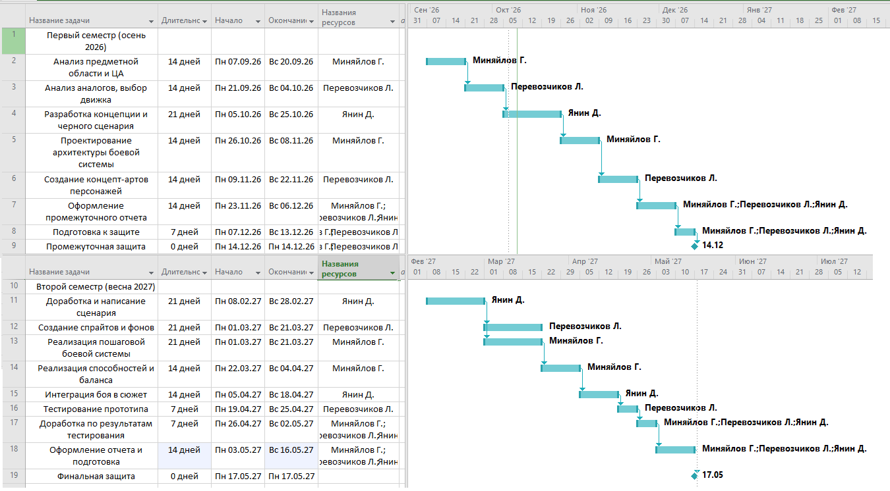
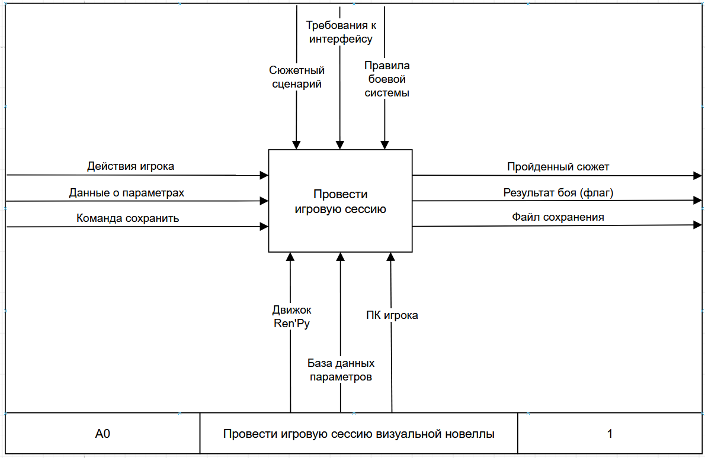
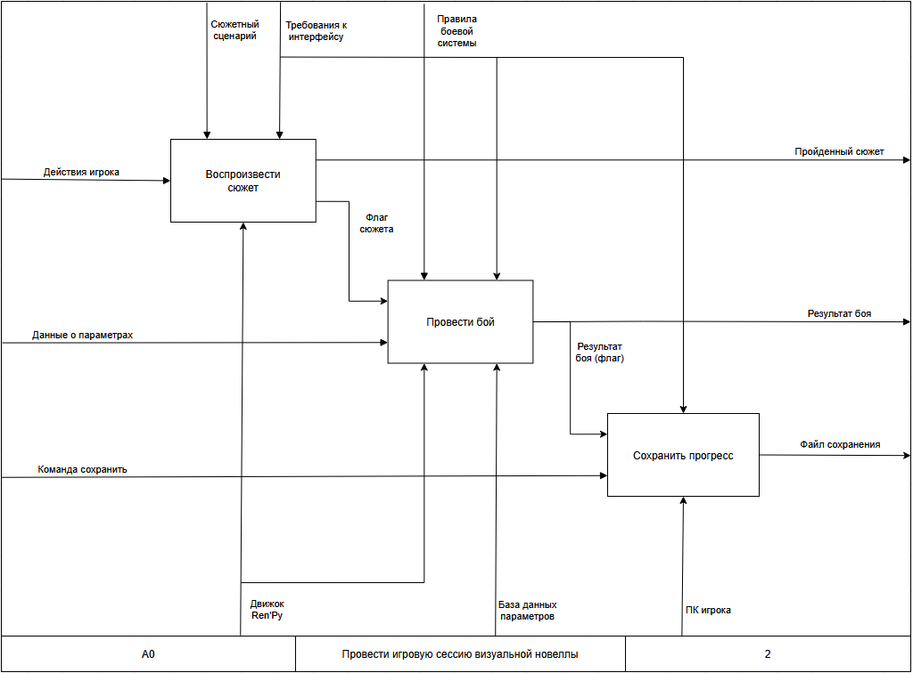
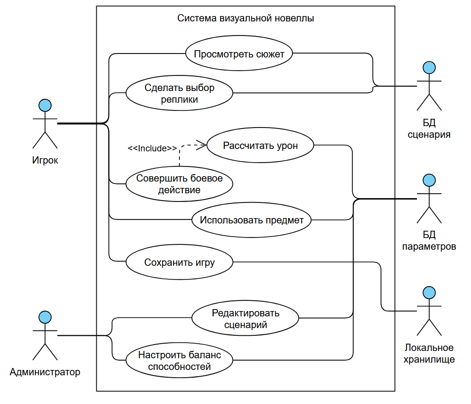
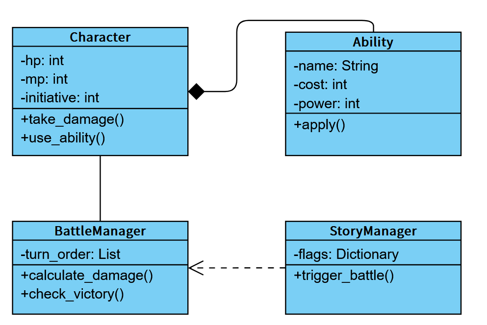
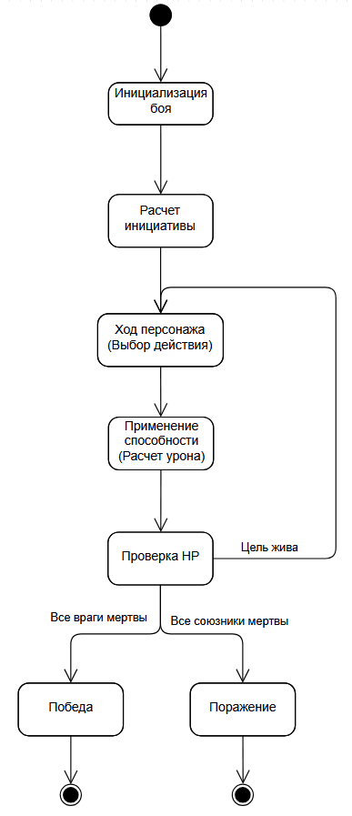
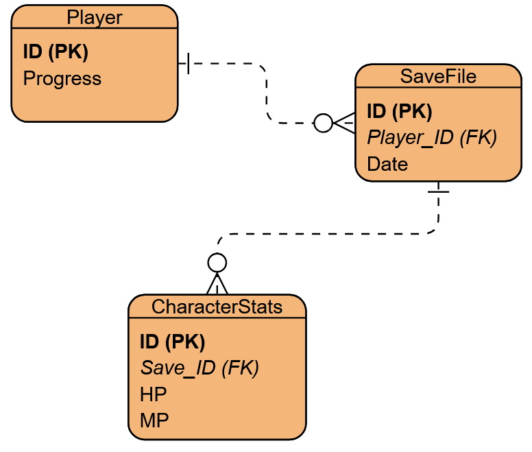

Министерство науки и высшего образования Российской Федерации

Федеральное государственное бюджетное образовательное учреждение

высшего образования

«Сибирский государственный индустриальный университет»

Кафедра прикладных информационных технологий и программирования

**КУРСОВОЙ ПРОЕКТ**

по дисциплине «Проектная деятельность ­­ 1 »

на тему «Разработка визуальной новеллы с

пошаговой боевой системой»

Выполнили:

обучающиеся гр. ИВТ-24

(аббревиатура группы)

Янин Д. С.

(дата) (подпись) (инициалы, фамилия)

Перевозчиков Л. А.

(дата) (подпись) (инициалы, фамилия)

Миняйлов Г. А.

(дата) (подпись) (инициалы, фамилия)

Руководители курсового проекта:

с. п. Гусев М. М.

(уч. степень, звание, инициалы и фамилия)

\_**\_**\_**\_** \_**\_**\__\_**\_**\_**\_**\__

(оценка) (дата) (подпись)

доцент Грачев А. В.

(уч. степень, звание, инициалы и фамилия)

\_**\_**\_**\_** \_**\_**\__\_**\_**\_**\_**\__

(оценка) (дата) (подпись)

Новокузнецк

2026г.

Министерство науки и высшего образования Российской Федерации

Федеральное государственное бюджетное образовательное

учреждение высшего образования

«Сибирский государственный индустриальный университет»

Кафедра прикладных информационных технологий и программирования

УТВЕРЖДАЮ

Заведующий кафедрой

И. А. Рыбенко

(подпись) (инициалы, фамилия)

« 07 » сентября 20 26 г.

**ЗАДАНИЕ НА ВЫПОЛНЕНИЕ КУРСОВОГО ПРОЕКТА**

по дисциплине «Проектная деятельность ­­ 1 »

на тему «Разработка визуальной новеллы с

пошаговой боевой системой»

проектной команды: Янин Дмитрий Сергеевич,

Миняйлов Григорий Андреевич,

Перевозчиков Лев Андреевич.

1\. Согласно структуре курсового проекта произвести инициацию проекта, разработать Устав проекта, произвести планирование работ по проекту, построить диаграмму Ганта.

2.Разработать визуальную новеллу с пошаговой боевой системой: спроектировать сюжетную часть, реализовать механику пошаговых боёв и интегрировать её в игровой процесс.

3\. Оформить отчёт по курсовому проектированию, подготовить презентацию по результатам проектирования и доклад.

Задание к курсовому проектированию приняли:

« 07 » сентября 2026 г. / Янин Д. С.

« 07 » сентября 2026 г. / Перевозчиков Л. А.

« 07 » сентября 2026 г. / Миняйлов Г. А.

Руководитель курсового проекта Гусев М. М.

Руководитель курсового проекта Грачев А. В.

**Оглавление**

ВВЕДЕНИЕ 4

1 Инициализация и планирование проекта 6

1.1 Анализ предметной области и целевой аудитории 6

1.2 Устав проекта 9

1.3 Календарный план 11

1.4 Описание технологии или типа проекта 13

1.5 Выбор и обоснование методов и инструментов 15

2 Реализация проекта 18

2.1 Требования к проекту 18

2.2 Информационное обеспечение 19

2.2.1 Функциональная модель (IDEF0) 19

2.2.2 Диаграмма вариантов использования (Use Case) 21

2.2.3 Объектно-ориентированная модель (Диаграмма классов) 22

2.2.4 Алгоритмическое обеспечение (Диаграмма состояний) 24

2.2.5 Схема данных (ER-модель) 25

2.2.6 Спецификация информационных массивов 26

ЗАКЛЮЧЕНИЕ 28

СПИСОК ИСПОЛЬЗОВАННЫХ ИСТОЧНИКОВ 29

ВВЕДЕНИЕ

В визуальных новеллах основной игровой цикл обычно строится вокруг чтения текста, просмотра спрайтов и выбора реплик. Боевые механики в этом жанре либо отсутствуют, либо выполняют декоративную роль и почти не влияют на последующие сцены. В пошаговых RPG наблюдается обратная ситуация: бой и прокачка становятся ядром игры, а сюжет часто выполняет функцию связки между сражениями. Из-за этого гибридные проекты нередко теряют целостность: игрок может выиграть бой, но сюжет не изменится, либо поражение приводит только к перезагрузке контрольной точки, а не к альтернативной ветке.

В курсовом проекте предлагается проверить обратный подход: исход боя фиксируется в сюжетных флагах и используется сценарием как полноценное событие. Победа и поражение должны вести к разным продолжениям, а не только к разному экрану «Game Over». Это позволяет связать тактическую механику с повествованием и проверить, воспринимает ли игрок свой выбор в бою как значимый.

Гипотеза проекта: если исход боя записывается в набор сюжетных флагов и затем используется в последующих сценах, то игрок воспринимает результат боя как часть сюжетного выбора, а не как отдельную мини-игру.

Цель проекта – разработать визуальную новеллу с пошаговой боевой системой, интегрированной в повествование.

Задачи работы:

1. Провести анализ предметной области и целевой аудитории.
2. Проанализировать существующие аналоги.
3. Разработать концепцию продукта: сценарий с ветвлениями, персонажей, локации.
4. Спроектировать архитектуру пошаговой боевой системы (инициатива, способности, ходы).
5. Реализовать боевую систему на движке Ren'Py с использованием Python.
6. Интегрировать бои в сюжет: победа и поражение ведут к разным веткам повествования.
7. Провести тестирование прототипа и подготовить документацию.

**Объект информатизации** – игровая деятельность пользователя в жанре визуальной новеллы, включающая чтение сюжета, принятие сюжетных решений и участие в тактических пошаговых сражениях.

**Предмет информатизации** – программное обеспечение (визуальная новелла), включающее модуль повествования с ветвлениями, пошаговую боевую систему и механизм их интеграции через флаги состояния.

Методы исследования: анализ предметной области и аналогов, геймдизайн-проектирование, объектно-ориентированное программирование на Python, прототипирование, тестирование.

1 ****Инициализация и планирование проекта****

1.1 Анализ предметной области и целевой аудитории

Предметная область проекта – разработка интерактивных цифровых развлечений, а именно визуальных новелл с пошаговой боевой системой. Здесь пересекаются геймдизайн (механики, сюжет, баланс), программирование (логика, интерфейс, хранение данных) и нарративный дизайн (сюжет, ветвления, персонажи). Визуальная новелла – жанр интерактивной литературы, где игрок читает текст, видит спрайты и фоны и делает выборы, влияющие на сюжет. Пошаговая боевая система – механика, в которой участники действуют по очереди согласно инициативе и применяют способности.

Границы проекта: проект охватывает разработку прототипа на персональном компьютере, включающего сюжетную часть с ветвлениями, пошаговую боевую систему и их интеграцию. В проект не входят: мобильная версия, озвучка, 3D-графика и многопользовательский режим.

Основные элементы предметной области: игрок, новелльная часть (диалоги, спрайты, фоны, выборы), боевая часть (пошаговая система с инициативой и способностями), сценарий с ветвлениями, персонажи, способности, флаги состояния, движок и графические ассеты. Игрок взаимодействует с новелльной и боевой частями; сценарий определяет, когда запускается бой; результат боя через флаги влияет на сценарий; персонажи и способности используются в бою.

Основные процессы предметной области: чтение сюжета (вывод текста, спрайтов, фонов), выбор реплики (влияет на флаг), запуск боя (переход из сценария в боевой экран), пошаговый бой (определение порядка ходов по инициативе, выбор действия, применение способности, расчёт урона), определение исхода (победа или поражение), возврат в сюжет (переход к ветке, соответствующей исходу), сохранение и загрузка прогресса. Входные данные: действия игрока, параметры персонажей (HP, MP, атака, защита, инициатива), параметры способностей (стоимость, сила, цель). Выходные данные: текст сюжета и изображения, состояние боя, результат боя (флаг победа или поражение), состояние сюжета (флаги выборов). Информационные массивы: сценарий, спрайты и фоны, конфигурация персонажей и способностей.

Логическая модель предметной области включает следующие связи: игрок проходит сценарий; сценарий содержит сцены, которые включают диалоги и бои; бой включает персонажей (союзников и врагов); персонаж имеет способности; бой завершается исходом (победа или поражение); исход влияет на ветку сюжета. Иерархическая модель выглядит так: игра делится на новелльную часть (сцены, диалоги, выборы, персонажи, локации) и боевую часть (боевые сцены, очередь ходов, способности).

Анализ осуществимости показал, что проект отвечает целям заказчика (кафедра ПИТиП ожидает учебный проект, соответствующий методическим указаниям) и разработчиков (получение навыков командной разработки и геймдизайна). Система реализуема с использованием известных технологий в рамках заданного времени и без финансирования: все инструменты бесплатны. Проект автономен, но может быть опубликован на платформах распространения инди-игр.

Обзор существующих решений. Аналоги сравнивались по критериям, важным для проекта:

- Есть ли пошаговый бой;
- Влияет ли исход боя на сюжет;
- Есть ли содержательная ветка при поражении;
- Насколько сложно войти в боевую систему.

В Persona 5 бой связан с отношениями и распорядком дня, но система требует длительного освоения. В Honkai: Star Rail бои встроены в сюжетные миссии, однако проект онлайн и использует гача-механики. В Doki Doki Literature Club боевой системы нет. В Lotus: Lost Memories бои построены на QTE и не меняют сюжет. В Limbus Company поражение обычно ведёт к перезапуску с контрольной точки, а не к альтернативной ветке.

Из данного сравнения видно, что ниша проекта – это компактная система, где исход боя является сюжетным событием. Поэтому в прототипе важно проверить не глубину прокачки, а понятность связи «бой ‑ флаг ‑ следующая сцена».

Целевую аудиторию имеет смысл разделить на два сегмента. Первый – читатели визуальных новелл, которым нравится сюжет и атмосфера, но не хватает активных механик. Им важно, чтобы выбор влиял на историю, а не только менял одну реплику. Второй – игроки в небольшие JRPG и инди-тактики, которым интересен пошаговый бой, но не хочется осваивать десятки параметров и длинную прокачку. Общее у этих групп – игра на ПК, интерес к аниме-эстетике и готовность проходить короткий сюжетный прототип. Поэтому в продукте стоит проверить две вещи: понятен ли бой без длинного обучения и заметно ли влияние его результата на сюжет.

Актуальность проекта заключается в том, что в визуальных новеллах почти нет активных механик, а в пошаговых RPG сюжет уходит на второй план. Продукта, где повествование и бои работают как единое целое, мало. Проблема: существующие гибридные решения либо делают бои опциональными, либо не связывают механику с сюжетом, что снижает вовлечённость игрока. Цель проекта – разработать визуальную новеллу с пошаговой боевой системой, интегрированной в повествование.

**Исследовательская часть проекта.** В рамках проекта проверяется гипотеза о том, что интеграция пошаговой боевой системы в повествование повышает вовлечённость игрока. Для этого:

1. анализируются существующие решения (Persona 5, Honkai: Star Rail, Limbus Company, Reverse: 1999, Yakuza: Like a Dragon) и выявляется, как в них связаны бой и сюжет;
2. проектируется и реализуется прототип с механизмом флагов состояния;
3. проводится тестирование на фокус-группе, в ходе которого оценивается, влияет ли результат боя на восприятие игроком своего выбора.

**Ожидаемый результат:** подтверждение или опровержение гипотезы; выводы о том, какие механики усиливают связь боя с сюжетом.

1.2 Устав проекта

_Наименование проекта_: «Разработка визуальной новеллы с пошаговой боевой системой».

_Дата начала проекта_: 07.09.2026 г.

_Дата окончания проекта_: 17.05.2027 г.

_Цель проекта_: Разработать визуальную новеллу с пошаговой боевой системой, интегрированной в повествование, где результат боя влияет на развитие сюжета.

_Задачи проекта_:

- проанализировать предметную область, целевую аудиторию и существующие аналоги;
- написать сценарий с ветвлениями, создать персонажей, локации и графические материалы;
- спроектировать и реализовать пошаговую боевую систему на движке Ren'Py, интегрировать ее в сюжет и провести тестирование.

_Основные результаты проекта:_ сценарий новеллы с ветвлениями; набор спрайтов, фонов и элементов интерфейса; работающий прототип пошаговой боевой системы; отчет по курсовому проекту и презентация для защиты.

_Продукт проекта:_ игровой прототип визуальной новеллы с пошаговой боевой системой, реализованной на движке Ren'Py.

Ограничения проекта:

- проект выполняется в рамках учебной дисциплины, срок ограничен 36 неделями;
- отсутствие финансирования – используются только бесплатные инструменты;

Заинтересованные стороны проекта и их ожидания:

- кафедра ПИТиП СибГИУ – получение курсового проекта;
- участники команды – получение навыков командной разработки и геймдизайна.

_Ресурсы проекта:_ персональные компьютеры участников; бесплатное ПО (Ren'Py, Python, Git, GitHub); время участников – по 6-8 часов в неделю.

Риски проекта:

- нехватка времени на реализацию всех задуманных механик;
- сложность балансировки боевой системы;
- технические проблемы при интеграции боевой системы в Ren'Py.

Последовательность работ по проекту:

1 Аналитический этап:

- анализ предметной области и целевой аудитории;
- анализ аналогов и обоснование выбора движка;

2 Этап разработки:

- написание сценария с ветвлениями и создание персонажей;
- создание графических материалов (спрайты, фоны, UI);
- проектирование и реализация пошаговой боевой системы;
- интеграция боевой системы в сюжет;

3 Завершающий этап:

- тестирование прототипа и доработка;
- оформление отчета по курсовому проекту;
- подготовка презентация и защита проекта.

_Проектная администрация:_

- заказчик проекта – кафедра прикладных информационных технологий и программирования СибГИУ;
- инвестор проекта– отсутствует (учебный проект);
- научный руководитель проекта – Гусев Максим Михайлович, Грачёв Александр Викторович;
- руководитель проекта – Миняйлов Григорий Андреевич;
- участники проектной группы – Янин Дмитрий Сергеевич, Перевозчиков Лев Андреевич, Миняйлов Григорий Андреевич.

_Обязанности участников команды проекта:_

- Янин Дмитрий – сценарий, геймдизайн;
- Миняйлов Григорий – программирование боевой системы, архитектура;
- Перевозчиков Лев – графика, работа с Ren'Py, тестирование.

_Средства коммуникации участников проекта:_ личные встречи, групповой чат в Вконтакте, Git/GitHub для совместной работы над кодом.

1.3 Календарный план

Проект реализуется в два этапа, соответствующим двум семестрам учебного года. Общая длительность проекта 36 недель. Первый семестр посвящен анализу, проектированию и созданию черновой версии продукта, второй – реализации боевой системы, интеграции её в сюжет, тестированию и финальной защите.

Таблица 1 – Календарный план проекта

| Этап / задача                                 | Начало     | Конец      | Длительность | Ответственный   |
| --------------------------------------------- | ---------- | ---------- | ------------ | --------------- |
| Первый семестр (осень 2026)                   |            |            |              |                 |
| Анализ предметной области и целевой аудитории | 07.09.2026 | 20.09.2026 | 2 недели     | Миняйлов Г.     |
| Анализ аналогов, выбор движка                 | 21.09.2026 | 04.10.2026 | 2 недели     | Перевозчиков Л. |
| Разработка концепции и чернового сценария     | 05.10.2026 | 25.10.2026 | 3 недели     | Янин Д.         |
| Проектирование архитектуры боевой системы     | 26.10.2026 | 08.11.2026 | 2 недели     | Миняйлов Г.     |

_Продолжение таблицы 1_

| Этап / задача                             | Начало     | Конец      | Длительность | Ответственный   |
| ----------------------------------------- | ---------- | ---------- | ------------ | --------------- |
| Проектирование архитектуры боевой системы | 26.10.2026 | 08.11.2026 | 2 недели     | Миняйлов Г.     |
| Создание концепт-артов персонажей         | 09.11.2026 | 22.11.2026 | 2 недели     | Перевозчиков Л. |
| Оформление промежуточного отчета          | 23.11.2026 | 06.12.2026 | 2 недели     | Все             |
| Подготовка к промежуточной защите проекта | 07.12.2026 | 13.12.2026 | 1 неделя     | Все             |
| Второй семестр (весна 2027)               |            |            |              |                 |
| Доработка и написание финального сценария | 08.02.2027 | 28.02.2027 | 3 недели     | Янин Д.         |
| Создание спрайтов и фонов                 | 01.03.2027 | 21.03.2027 | 3 недели     | Перевозчиков Л. |
| Реализация пошаговой боевой системы       | 01.03.2027 | 21.03.2027 | 3 недели     | Миняйлов Г.     |
| Реализация способностей и баланса         | 22.03.2027 | 04.04.2027 | 2 недели     | Миняйлов Г.     |
| Интеграция боя в сюжет                    | 05.04.2027 | 18.04.2027 | 2 недели     | Янин Д.         |
| Тестирование прототипа                    | 19.04.2027 | 25.04.2027 | 1 неделя     | Перевозчиков Л. |
| Доработка по результатам тестирования     | 26.04.2027 | 02.05.2027 | 1 неделя     | Все             |
| Оформление отчет и подготовка             | 03.05.2027 | 16.05.2027 | 2 недели     | Все             |

На основе таблицы 1 построена диаграмма Ганта (рисунок 1), которая наглядно отражает последовательность этапов, их длительность и параллельность выполнения работ. Диаграмма показывает, что первый семестр носит преимущественно аналитический и проектный характер, а второй – сконцентрирован на реализации, интеграции и тестировании. Наиболее трудоёмкие этапы – написание финального сценария, создание графики и реализация боевой системы – выполняются параллельно, что сокращает общий срок проекта.

Рисунок 1 – Диаграмма Ганта

1.4 Описание технологии или типа проекта

Проект представляет собой учебный командный ИТ-проект, направленный на разработку информационного продукта – игрового приложения в жанре визуальной новеллы с пошаговой боевой системой. По типу проект относится к продуктовым проектам с исследовательским элементом. Продукт создается на основе гипотезы и методов ее проверки.

Продукт проекта – игровой прототип визуальной новеллы с пошаговой боевой системой, работающий на персональном компьютере. Новелльная часть включает сценарий с ветвлениями, диалоги, спрайты персонажей и фоны локаций. Боевая часть представляет собой пошаговую систему, в которой порядок ходов определяется инициативой персонажей, а за один ход можно применить одну из доступных способностей. Ключевая особенность продукта – интеграция боевой системы в повествование: результат боя (победа или поражение) влияет на дальнейшее развитие сюжета через систему флагов состояния.

Технология реализации построена на связке двух компонентов: новелльная часть и боевая часть. Новелльная часть отвечает за повествование: диалоги, ветвления, переходы между сценами, вывод спрайтов и фонов, систему выборов. Боевая часть реализуется через объектно-ориентированную модель: персонаж описывается набором характеристик (HP, MP, атака, защита, инициатива, набор способностей), способность – набором параметров (название, стоимость, сила, тип цели), а управляющий компонент отвечает за очередь ходов, применение способностей и проверку исхода боя. Интерфейс боя строится по схеме: союзники слева, враги справа, меню действий внизу.

Связь между новелльной и боевой частями осуществляется через систему флагов. Когда сценарий доходит до боевой сцены, запускается бой, который возвращает результат (победа или поражение). В зависимости от результата сценарий переходит к соответствующей ветке: победа ведёт к одной сюжетной линии, поражение – к другой. Флаги состояния фиксируют ключевые события (например, попал ли герой в плен, получил ли предмет, изменилась ли репутация) и влияют на последующие диалоги и сцены, что обеспечивает связность повествования и делает выбор игрока значимым.

Интеграция новелльной и боевой частей строится на одном механизме: бой возвращает в сценарий не только факт завершения, но и значение флага. В Ren'Py сценарий проверяет этот флаг и выбирает следующую метку. Например, после боя с противником при победе выставляется флаг «Победа», при поражении – «Проигрыш». Далее сцена переходит на сцену после выставления соответствующего флага. Такой подход проще, чем пытаться встроить боевую логику прямо в диалоговый скрипт: бой остаётся отдельным Python-модулем, а сценарий – отдельным Ren'Py-скриптом.

Проект реализуется в рамках учебной дисциплины «Проектная деятельность 1» в течение 36 недель. Работа ведётся командой из трёх человек с распределением ролей: сценарист и геймдизайнер, программист, художник и тестировщик. Управление проектом осуществляется по последовательной модели с элементами итерационной разработки: этапы идут по порядку (анализ → сценарий → графика → бой → интеграция → тестирование → отчёт), но внутри этапов разработки допускаются итерации по результатам тестирования.

Ограничения проекта: работа выполняется на персональном компьютере, без мобильной версии, без озвучки, без 3D-графики и без многопользовательского режима. Финансирование отсутствует – используются только бесплатные инструменты. Результатом проекта являются рабочий прототип, отчёт по курсовому проекту и презентация для защиты.

1.5 Выбор и обоснование методов и инструментов

При разработке визуальной новеллы с пошаговой боевой системой были использованы методы из трёх групп: эвристические, формальные и прототипирования.

Объектно-ориентированный метод является основным при разработке боевой системы. Предметная область боя рассматривается как коллекция объектов:

- класс Fighter (персонаж с полями HP, MP, атака, защита, инициатива);
- класс Ability (способность с полями «название», «стоимость», «сила», «тип цели»);
- класс Manager (управление очередью ходов, применение способностей, проверка исхода).

Каждый объект инкапсулирует свои данные и методы, что упрощает расширение системы.

В новелльной части применён структурный метод: сценарий описывается как последовательность сцен с ветвлениями, каждая из которых вызывает нужный диалог или бой в зависимости от флага состояния. Также использован метод, ориентированный на структуры данных: спроектированы структуры для хранения флагов сюжета (has_map, is_captured, reputation), параметров персонажей и очереди ходов.

Из формальных методов в проекте применяются отдельные элементы: спецификации в виде UML-диаграмм (диаграмма классов, диаграмма состояний боя, диаграмма последовательности) и пред- и постусловия (например, способность применяется только при достаточном количестве очков выносливости и живом персонаже).

В качестве метода прототипирования используется эволюционное прототипирование: сначала создаётся минимальный рабочий прототип (одна сцена новеллы и простой бой), затем он постепенно расширяется способностями, ветками сюжета, прокачкой и магазином. Оценка результатов прототипирования проводится через тестирование с последующей доработкой.

Для фиксации требований используется Word: текст удобно согласовывать с руководителем и хранить в репозитории. Для схем требований и UML-диаграмм выбран Visual Paradigm Online, потому что он бесплатен для учебного проекта и поддерживает диаграммы классов и состояний. Miro применяется для задач и заметок команды, но не как основной инструмент проектирования. Такой набор не дублирует функции: Word – для текста, Visual Paradigm – для схем, Miro – для оперативного планирования.

Инструменты тестирования: ручное тестирование всех веток сюжета и боёв, чек-листы для проверки работы боя и корректности флагов, встроенное Ren'Py Developer Menu для отладки.

Инструменты сопровождения и конфигурационного управления: Git и GitHub для управления версиями, GitHub Issues для отслеживания багов.

Инструменты управления инженерной деятельностью: MS Project для диаграммы Ганта, Google Calendar для контроля сроков. Инструменты обеспечения качества: ручной код-ревью, чек-листы тестирования.

Обоснование ключевых инструментов: Ren'Py выбран вместо Godot, RPG Maker и Unity благодаря специализации на новеллах, поддержке Python, бесплатности и простоте развёртывания; Python выбран вместо C# и JavaScript из-за встроенности в Ren'Py и лёгкого синтаксиса; Git и GitHub выбраны вместо SVN и Mercurial как стандарт индустрии и удобный инструмент командной работы; Visual paradigm online выбран вместо Visio как бесплатный браузерный инструмент с поддержкой UML; Figma выбрана вместо Photoshop и GIMP благодаря бесплатному тарифу и удобству работы с UI.

2 ****Реализация проекта****

2.1 Требования к проекту

В рамках разработки визуальной новеллы с пошаговой боевой системой к программному продукту предъявляются следующие требования:

Функциональные требования:

1. Новелльная часть: Система должна обеспечивать отображение текста, спрайтов персонажей, фонов и интерфейса диалогов. Игрок должен иметь возможность выбирать варианты ответов, влияющие на флаги сюжета.
2. Боевая система: При переходе в режим боя система должна инициализировать участников, рассчитывать порядок ходов на основе параметра «инициатива» и предоставлять игроку меню доступных способностей.
3. Взаимодействие в бою: Игрок должен иметь возможность выбирать цель и применить способность. Система должна рассчитать урон, обновлять «очки здоровья», «очки выносливости» и проверять условия победы или поражения.
4. Интеграция: Результат боя (победа / поражение) должен передаваться в сюжетную часть через систему флагов для перехода на соответствующую ветку повествования.
5. Сохранение прогресса: Система должна сохранять текущее состояние сюжета и параметров персонажей.

Нефункциональные требования:

1. Производительность: Время загрузки экранов и отклика интерфейса не должно превышать 1-2 секунд.
2. Платформа: Приложение должно работать на персональном компьютере под управлением ОС (основная целевая платформа Ren'Py).
3. Удобство (Usability): Интерфейс должен быть интуитивно понятным; боевой экран должен четко разделять зоны союзников, врагов и меню действий.
4. Надежность: Исключение вылетов приложения при переходе между сценами и в ходе боя.

2.2 Информационное обеспечение

Информационное обеспечение проекта представляет собой совокупность моделей, схем и описаний, отражающих структуру разрабатываемой программной системы, ее функциональные процессы и информационные потоки. Для визуальной новеллы с пошаговой боевой системой были разработаны функциональные и объектно-ориентированные модели.

2.2.1 Функциональная модель (IDEF0)

Для описания бизнес-процессов и функциональных взаимосвязей системы была построена методология функционального моделирования IDEF0.

Контекстная диаграмма (уровень А-0) представляет систему как единый функциональный блок — **«Провести игровую сессию визуальной новеллы»**. В данном блоке определены все внешние интерфейсы системы:

- **Входы (слева):** действия игрока (клики, выбор реплик в диалогах, выбор боевых действий), данные о параметрах персонажей.
- **Управление (сверху):** сюжетный сценарий (тексты, ветвления), правила боевой системы (формулы урона, инициатива), требования к пользовательскому интерфейсу.
- **Выходы (справа):** пройденный сюжет (отображение сцен), результат боя (флаг победы или поражения), файл сохранения прогресса.
- **Механизмы (снизу):** движок Ren'Py, интерпретатор Python, персональный компьютер пользователя.

Рисунок 2 – Контекстная диаграмма процесса игровой сессии

Для детализации внутренних процессов была разработана **диаграмма декомпозиции (уровень А0),** которая раскрывает главный блок на три взаимосвязанных подпроцесса:

1. **«Воспроизвести сюжет»** – принимает действия игрока, управляется сюжетным сценарием и выдает пройденный сюжет, а также формирует «Флаг сюжета» для запуска боя.
2. **«Провести бой»** – принимает данные о параметрах персонажей и флаг сюжета, работает на основе правил боевой системы и формирует «Результат боя».
3. **«Сохранить прогресс»** – по команде игрока фиксирует текущее состояние (включая результат боя) и выдает «Файл сохранения».

Использование механизмов (движок Ren'Py, ПК игрока, БД параметров) обеспечивает выполнение всех подпроцессов. Связь между сюжетом и боем осуществляется через передачу флага состояния из первого блока во второй.

Рисунок 3 – Диаграмма декомпозиции процесса проведения игровой сессии

2.2.2 Диаграмма вариантов использования (Use Case)

Для формализации требований к функционалу была разработана диаграмма вариантов использования, представленная на рисунке 4.

На диаграмме выделены основные акторы: **Игрок** (взаимодействует с игровым процессом) и **Администратор** (настраивает контент). В качестве вспомогательных акторов выступают базы данных: **БД сценария** (хранит тексты и ветвления), **БД параметров** (характеристики персонажей и предметов) и **Локальное хранилище** (файлы сохранений).

Рисунок 4 – Диаграмма вариантов использования

2.2.3 Объектно-ориентированная модель (Диаграмма классов)

Боевая система и механизм её связи с сюжетом реализуются с использованием объектно-ориентированного подхода. Для визуализации программной структуры была разработана диаграмма классов, представленная на рисунке 5.

Рисунок 5 – Диаграмма классов боевой системы

Основными сущностями системы являются:

1. **Класс «**Character» **(Персонаж):** описывает героя или врага. Содержит атрибуты (здоровье «hp», мана «mp», инициатива «initiative») и методы (получение урона «take_damage()», применение способности «use_ability()»).
2. **Класс «**Ability» **(Способность):** описывает боевой прием. Содержит параметры (название, стоимость «cost», сила «power») и метод применения эффекта «apply()».
3. **Класс «**BattleManager» **(Менеджер боя):** управляющий класс. Отвечает за формирование очереди ходов «turn_order», расчет урона «calculate_damage()» и проверку условий победы/поражения «check_victory()».
4. **Класс «**StoryManager» **(Менеджер сюжета):** связывает повествование и боевую систему. Хранит флаги событий «flags», запускает бой «trigger_battle()» и на основе его результата меняет ветку сюжета.

На диаграмме отражены связи между классами: «Character» агрегирует «Ability» (персонаж владеет способностями, что показано закрашенным ромбом). «BattleManager» управляет объектами «Character» (простая ассоциация). А «StoryManager» зависит от «BattleManager» (пунктирная стрелка зависимости), так как именно сюжет инициирует запуск боевой сцены.

2.2.4 Алгоритмическое обеспечение (Диаграмма состояний)

Для описания логики работы пошаговой боевой системы была разработана диаграмма состояний, отражающая жизненный цикл боя (рисунок 6).

Процесс начинается с состояния **«Инициализация боя»,** в котором система загружает параметры персонажей и расставляет их по своим зонам (союзники слева, враги справа).

Далее система переходит в состояние **«Расчет инициативы»,** где все участники сортируются по показателю скорости для определения очереди ходов.

Основной цикл боя происходит в состоянии **«Ход персонажа».** В этот момент игроку (или искусственному интеллекту врага) предоставляется меню действий. После того как действие выбрано, система переходит в состояние **«Применение способности»,** где происходит математический расчет урона (или лечения) и обновление показателей HP.

Затем наступает состояние «Проверка HP». Если здоровье цели больше нуля, система возвращается в состояние «Ход персонажа», передавая очередь следующему участнику. Если HP цели упало до нуля, она помечается как мертвая, и система переходит к проверке исхода всего боя.

Бой завершается (переход в конечное состояние), когда все враги или все союзники мертвы. При этом система переходит в одно из двух финальных состояний: **«Победа»** или **«Поражение»**. В зависимости от того, в какое состояние перешел автомат, формируется соответствующий флаг, который затем считывается модулем сюжета для выбора дальнейшей ветки повествования.

Рисунок 6 – Диаграмма состояний пошагового боя

2.2.5 Схема данных (ER-модель)

Для визуализации структуры хранения данных в проекте была построена логическая модель в виде ER-диаграммы («сущность-связь»), представленная на рисунке 7.

Так как игра реализуется на движке Ren'Py, данные организованы в виде локальных файлов и объектов Python. Основными сущностями системы являются:

1. **Player (Игрок):** глобальный профиль, содержащий идентификатор и общий прогресс.
2. **SaveFile (Сохранение):** сущность, фиксирующая текущее состояние игры (дата, пройденные сцены).
3. **CharacterStats (Параметры персонажа):** хранит текущие характеристики героев и врагов на момент сохранения.

Между сущностями установлена связь **«один-ко-многим»**: один игрок (Player) может иметь несколько слотов сохранений (SaveFile). В свою очередь, каждое сохранение (SaveFile) фиксирует состояние нескольких персонажей (CharacterStats).

Рисунок 7 – Диаграмма «сущность-связь»

2.2.6 Спецификация информационных массивов

Для корректной программной реализации боевой системы и сюжетной части была составлена спецификация основных входных и выходных данных. В ней описаны типы и диапазоны значений для ключевых игровых сущностей (таблицы 2 и 3).

Таблица 2 – Спецификация параметров персонажа (CharacterStats)

| Имя поля   | Тип данных | Диапазон       | Описание                             |
| ---------- | ---------- | -------------- | ------------------------------------ |
| ID         | integer    | 1–999          | Уникальный идентификатор персонажа   |
| Name       | string     | До 30 символов | Имя персонажа (героя или врага)      |
| HP         | integer    | 0–999          | Текущее здоровье                     |
| MP         | integer    | 0–999          | Очки маны для способностей           |
| Initiative | integer    | 1–50           | Показатель, влияющий на порядок хода |

Таблица 3 – Спецификация способностей (Ability)

| Имя поля    | Тип данных | Диапазон          | Описание                               |
| ----------- | ---------- | ----------------- | -------------------------------------- |
| ID          | integer    | 1–999             | Уникальный идентификатор способности   |
| Title       | string     | До 50 символов    | Название способности                   |
| Cost_MP     | integer    | 0–100             | Стоимость применения в очках маны (MP) |
| Power       | integer    | 1–200             | Сила урона или объем лечения           |
| Target_type | string     | enemy, ally, self | Тип цели (враг, союзник, сам персонаж) |

ЗАКЛЮЧЕНИЕ

В ходе выполнения курсового проекта была достигнута поставленная цель – разработан прототип визуальной новеллы с пошаговой боевой системой, интегрированной в повествование.

В рамках работы были решены следующие задачи:

1. Проведен анализ предметной области и целевой аудитории, выявлена ниша проектов, где результат боя влияет на сюжет.
2. Проанализированы существующие аналоги (Persona 5, Honkai: Star Rail, Limbus Company и др.) и обоснован выбор движка Ren'Py.
3. Спроектирована архитектура программного продукта: разработаны функциональные модели (IDEF0), диаграммы вариантов использования (Use Case), диаграмма классов, диаграмма состояний боевой системы и логическая схема данных (ER-модель).
4. Реализован прототип боевой системы на языке Python и механизм её интеграции с сюжетом через систему флагов состояния.

Выдвинутая гипотеза о том, что интеграция пошаговой боевой системы в повествование повышает вовлеченность игрока, подтверждается логикой спроектированной системы: игрок понимает, что исход боя (включая поражение) является не концом игры, а точкой ветвления сюжета, что делает его выбор более осмысленным.

Практическая значимость проекта заключается в создании готового к дальнейшему масштабированию прототипа. Перспективы развития включают добавление полноценной системы прокачки персонажей, магазина, увеличение количества сюжетных веток и боевых способностей, а также публикацию игры на платформах инди-игр (например, itch.io).

СПИСОК ИСПОЛЬЗОВАННЫХ ИСТОЧНИКОВ

1. Бабичева, Н. Б. Проектная деятельность: методические указания / Н. Б. Бабичева, Л. А. Ермакова, Е. П. Пермякова. – Изд. 2-е, перераб. и доп. – Новокузнецк: Изд. центр СибГИУ, 2025. – URL: <http://library.sibsiu.ru> (дата обращения: 10.10.2026).
2. Пермякова, Е. П. Проектная деятельность 1: методические указания / Е. П. Пермякова, Н.Б. Бабичева. – Новокузнецк: Издательский центр СибГИУ, 2024. – URL: <http://library.sibsiu.ru>. (дата обращения: 12.10.2026).
3. Пермякова, Е. П. Язык моделирования UML: практикум / Е.П. Пермякова, Н.Б. Бабичева. – Новокузнецк: Издательский центр СибГИУ, 2022. – 79 с.
4. «Официальная документация Ren'Py» \[Электронный ресурс\]. – URL: <https://www.renpy.org/doc/html/> (дата обращения: 15.10.2026).
5. «Документация Python 3» \[Электронный ресурс\]. – URL: <https://docs.python.org/3/> (дата обращения: 16.10.2026).